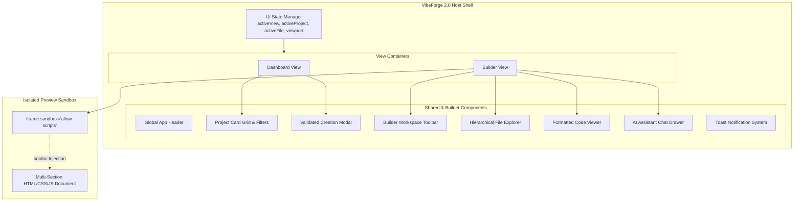
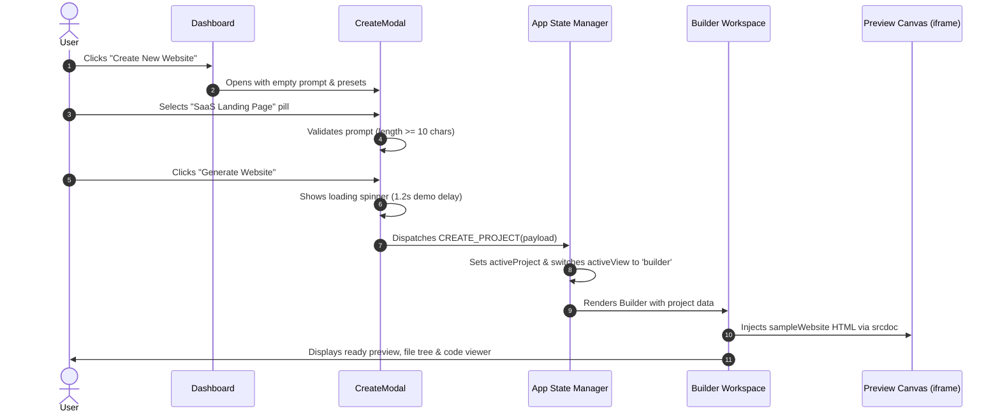

# Architecture Specification
## VibeForge 2.0 — System Architecture & Component Design

**Document Version:** 1.0.0  
**Phase:** Phase 1 (Foundation & UI)  
**Author:** Antigravity Senior Software Engineer & System Architect  

---

### 1. Architectural Style & Design Principles

VibeForge utilizes a **Client-Side Componentized SPA Architecture** with an **Isolated Sandboxed Subsystem** for live website previews.

#### Core Principles:
1. **Unidirectional Data Flow:** State is managed at the top-level application container (`App.jsx`) and passed down through strongly-typed props and callback actions.
2. **Zero-Trust Iframe Sandboxing:** The generated preview runs inside a constrained sub-document, preventing style contamination and script injection into the host IDE.
3. **Zero Local Dependencies:** Designed to run directly in modern browsers via standard web protocols and CDN-delivered ESM/standalone runtimes, respecting the zero-Node.js constraint.
4. **Predictable Component Separation:** Pure visual components are decoupled from demo data stores and layout orchestration.

---

### 2. High-Level Component Architecture



---

### 3. Directory & File Structure

```
c:/Users/DELL/Downloads/Antigravity IDE/
├── index.html              # Main HTML entry point (React 18 + Tailwind CDN + App Mount)
├── src/
│   ├── index.css           # Global CSS variables, scrollbars, glassmorphism, animations
│   ├── types.js            # Type definitions, interfaces, and state contracts
│   ├── mockData.js         # Curated demo projects, sample files, and AI prompt presets
│   ├── sampleWebsite.js    # Multi-section responsive website source code for preview
│   └── components/
│       ├── Header.jsx      # Top navigation header with branding and action pills
│       ├── Dashboard.jsx   # Dashboard with project search, categories, and grid
│       ├── CreateModal.jsx # Validated creation dialogue with demo mode indicators
│       ├── BuilderToolbar.jsx # Builder top bar (viewports, tabs, save status, export)
│       ├── FileExplorer.jsx   # Collapsible file tree with file metadata
│       ├── CodeViewer.jsx     # Read-only code viewer with line numbers & copy action
│       ├── PreviewCanvas.jsx  # Sandboxed iframe wrapper with animated viewport resizing
│       ├── AIChatPanel.jsx    # Collapsible AI prompt chat drawer with quick actions
│       └── Toast.jsx          # Ephemeral floating notification system
├── docs/                   # Full Architecture & Requirements Documentation
│   ├── PRD.md              # Product Requirements Document
│   ├── TRD.md              # Technical Requirements Document
│   ├── Architecture.md     # System Architecture & Component Design
│   ├── appFlow.md          # User Journey & Application Flow
│   ├── database.md         # Data Models, Schemas & Future Supabase Architecture
│   ├── design.md           # UI/UX Design System, Color Tokens & Typography
│   ├── Rules.md            # AI Development & Coding Rules
│   └── phases.md           # Implementation Roadmap & Verification Gates
├── PRD.md                  # Root copy of PRD
├── TRD.md                  # Root copy of TRD
├── Architecture.md         # Root copy of Architecture
├── appFlow.md              # Root copy of appFlow
├── database.md             # Root copy of database
├── design.md               # Root copy of design
├── Rules.md                # Root copy of Rules
└── phases.md               # Root copy of phases
```

---

### 4. Data Flow & State Lifecycle

#### 4.1 Creation Flow Sequence Diagram



#### 4.2 Viewport & View Mode State Switching
The Builder maintains two independent viewing axes:
1. **`activeTab` (`'preview'` | `'code'` | `'files'` | `'split'`):** Controls what panel is visible in the central workspace.
2. **`viewport` (`'desktop'` | `'tablet'` | `'mobile'`):** Modifies the width constraint of the preview container:
   - Desktop: `max-w-full` (100% up to 1280px)
   - Tablet: `max-w-[768px]`
   - Mobile: `max-w-[375px]`

---

### 5. Error Handling & Resilience Strategy

| Failure Scenario | Mitigation Strategy |
| :--- | :--- |
| **User enters empty or 3-character prompt** | Form validation disables submit button; helper text displays `"Prompt must be at least 10 characters long"`. |
| **User clicks unfinished feature (e.g. Export)** | Non-blocking modal displays scheduled phase details without throwing uncaught errors. |
| **Iframe script error in previewed website** | Parent window is isolated; iframe console errors do not propagate or crash the VibeForge React tree. |
| **Clipboard access denied by browser** | Fallback to legacy `document.execCommand('copy')` inside temporary off-screen textarea. |
