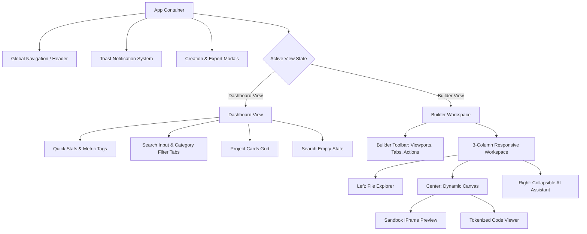

# Technical Requirements Document (TRD)
## VibeForge 2.0 — Architecture, Stack & Technical Specifications

**Document Version:** 1.0.0  
**Phase:** Phase 1 (Foundation & UI)  
**Author:** Antigravity Senior Software Engineer & Technical Architect  

---

### 1. Technology Stack & Rationale

#### 1.1 Host Environment Constraints
- **Host OS:** Windows 11
- **Node.js / npm Status:** Not installed on user's system (`CommandNotFoundException`).
- **Python Status:** Python 3.13.3 available.
- **Constraint Directive:** The user is a beginner BSCS student; zero installation of Node.js or mandatory terminal commands. The solution must run reliably in any modern web browser immediately upon double-clicking `index.html` or via lightweight preview.

#### 1.2 Chosen Stack for Phase 1

| Component | Technology | Rationale & Trade-offs |
| :--- | :--- | :--- |
| **Frontend Core** | **React 18 + ReactDOM 18** (Browser CDN / Standalone) | Industry standard component model. Provides declarative state management (`useState`, `useEffect`, `useMemo`). High portability. |
| **JSX Transpiler** | **Babel Standalone** (`@babel/standalone 7.23+`) | Enables writing clean, modern ES6+ React JSX components without requiring an ahead-of-time Node.js build pipeline or Webpack/Vite install. |
| **Styling** | **Tailwind CSS 3.4 (Play CDN) + Custom Vanilla CSS** | Delivers rapid, utility-first styling with exact design tokens, dark mode palette, and zero local compiler overhead. Augmented with `index.css` for custom scrollbars, animations, and glassmorphism. |
| **Iconography** | **Native Accessible Inline SVGs (Lucide Spec)** | 100% offline reliability. Eliminates external icon font CDN dependencies, network lag, and potential CORS blocks. |
| **Code Display** | **Sanitized Syntax Highlighting Component** | Structured tokenized display with line numbers, copy-to-clipboard API, and file size calculation. |
| **Preview Isolation** | **HTML5 `<iframe>` with sandbox attributes** | Completely isolates the sample website from VibeForge's host application DOM. Prevents style collisions and script contamination. |

---

### 2. System Architecture & Component Hierarchy



---

### 3. Security & Sandboxing Architecture

#### 3.1 Iframe Security Boundary
Generated and sample websites must never execute directly in the parent window.
```html
<iframe
  id="vibeforge-preview-frame"
  sandbox="allow-scripts allow-forms allow-same-origin"
  srcdoc="<!-- Sanitized HTML Document Content -->"
  title="VibeForge Website Preview"
  class="w-full h-full border-0 rounded-lg bg-white"
></iframe>
```
- **`allow-scripts`**: Permits client-side JavaScript within the previewed website (e.g., mobile hamburger menus, interactive sliders).
- **No `allow-top-navigation`**: Prevents the previewed website from redirecting the parent VibeForge application.
- **No `allow-modals`**: Prevents previewed sites from spawning blocking `alert()` or `prompt()` dialogues.

#### 3.2 Cross-Origin & Network Policy
- In Phase 1, all data is in-memory and local mock data.
- No network requests are made to third-party AI APIs or Supabase backends.
- Prevents leaking user prompt data or creating network dependency errors.

---

### 4. Browser Compatibility & Responsive Breakpoints

| Breakpoint | Viewport Width | Application Behavior |
| :--- | :--- | :--- |
| **Mobile (`sm`)** | `< 640px` | Single-column view; sidebar panels collapse into sliding drawers or tabs; top toolbar stacks compactly. |
| **Tablet (`md`)** | `640px - 1024px` | Two-column layout; AI chat panel collapses into a modal overlay; viewport scale adjusts. |
| **Desktop (`lg/xl`)** | `> 1024px` | Full three-pane IDE layout: File Tree (240px), Main Canvas (flexible flex-1), AI Panel (320px). |

#### Preview Canvas Simulated Viewports
1. **Desktop:** `100% width` (max 1200px container), aspect 16:10.
2. **Tablet:** Fixed `768px width`, simulated iPad aspect.
3. **Mobile:** Fixed `375px width`, simulated iPhone 14/15 aspect with subtle device frame shadow.

---

### 5. Technical Acceptance Criteria

- **TAC-001 (Zero-Install Execution):** Opening `index.html` in Chrome, Edge, Firefox, or Safari renders the application without console crashes.
- **TAC-002 (State Transitions):** Navigating from Dashboard -> Create Modal -> Builder -> Dashboard preserves state without page reloads.
- **TAC-003 (Search Latency):** Filtering 10+ projects runs in `< 50ms` using client-side memoized filter predicates.
- **TAC-004 (Code Copy Reliability):** Clicking "Copy Code" copies the full active file string to `navigator.clipboard` with fallback textarea execCommand and triggers an ephemeral toast.
- **TAC-005 (Viewport Toggle):** Switching viewports triggers a smooth CSS transition (`transition-all duration-300`) without reloading the iframe document.

---

### 6. Technical Limitations & Future Migration Path

1. **Phase 1 Limitation:** Babel Standalone transpilation occurs in the client browser during page load. For Phase 1 demo scale (< 2000 lines of component code), overhead is ~150ms.
2. **Phase 3 Path:** When Supabase is integrated, `@supabase/supabase-js` will be loaded via official ESM CDN (`https://esm.sh/@supabase/supabase-js@2`) with zero local npm install requirements.
3. **Phase 4 Path:** ZIP export will utilize client-side JSZip (`https://esm.sh/jszip`) + FileSaver (`https://esm.sh/file-saver`) to pack HTML/CSS/JS without needing a server-side build step.
