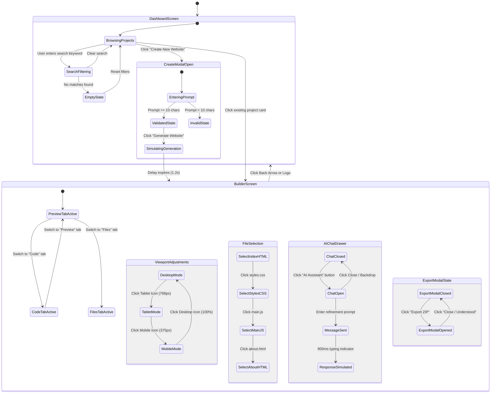

# Application & User Flow Specification (appFlow.md)
## VibeForge 2.0 — Navigation, Workflows & State Transitions

**Document Version:** 1.0.0  
**Phase:** Phase 1 (Foundation & UI)  
**Author:** Antigravity Senior Product Designer & Frontend Architect  

---

### 1. Screen Inventory & Navigation Map

---

### 2. Detailed User Journeys

#### Journey 1: Project Discovery & Filtering
1. **Entry Point:** User lands on the VibeForge Dashboard (`activeView = 'dashboard'`).
2. **Context Inspection:** User sees top navigation with VibeForge branding, global metrics tag (e.g., `"Phase 1: Foundation & UI"`), and the "Create New Website" CTA.
3. **Filtering:**
   - User types `"SaaS"` in the search bar -> Project list filters instantaneously to matching projects.
   - User clicks category pill `"Portfolio"` -> Grid filters by category tags.
   - User enters `"xyz123"` (no matches) -> System renders a clean Empty State card with a `"Clear Search"` button.
4. **Action:** User clicks on the demo project `"Apex Innovate - AI Robotics"`.
5. **Outcome:** Application transitions smoothly to the Builder Workspace loaded with Apex Innovate's file set and live preview.

#### Journey 2: Guided Website Creation (Demo Mode)
1. **Trigger:** User clicks `"Create New Website"` button in the Dashboard header or hero section.
2. **Modal Presentation:** A dark glassmorphic dialog opens with focus on the prompt textarea.
3. **Preset Selection:** User clicks the preset pill `"Cyberpunk Developer Portfolio"`. The textarea auto-populates with a rich, descriptive prompt.
4. **Validation Check:**
   - If prompt is empty or fewer than 10 characters: The "Generate Website" button remains disabled with helper text: *"Please enter at least 10 characters to describe your website."*
   - Once length >= 10: The button activates with a vibrant violet/blue glow.
5. **Generation Simulation:** User clicks `"Generate Website"`.
   - The button shows a pulsing spinner and label: `"Scaffolding project structure..."`.
   - Clear banner displays: *"Demo Mode: Loading pre-scaffolded responsive layout (Phase 1)"*.
6. **Completion:** After 1200ms, the modal closes and transitions the user directly to the Builder Workspace.

#### Journey 3: Multi-Viewport Inspection & Code Review
1. **Default State:** Inside the Builder Workspace, the canvas is set to **Desktop (100% width)** on the **Preview** tab.
2. **Responsive Verification:**
   - User clicks the **Tablet** viewport icon -> Canvas animates to `768px` width; preview layout refits responsively.
   - User clicks the **Mobile** viewport icon -> Canvas animates to `375px` width with simulated smartphone frame; mobile navigation hamburger renders inside the preview.
3. **Code Inspection:**
   - User clicks the **Code** tab in the top bar.
   - The central canvas switches from the iframe to the tokenized Code Viewer showing `index.html`.
   - User clicks `styles.css` in the left File Explorer -> Code viewer updates instantly with CSS rules.
   - User clicks the `"Copy Code"` button -> Code is copied to clipboard and a green checkmark toast appears for 2.5s.

#### Journey 4: AI Refinement Chat (Simulated Demo)
1. **Trigger:** User clicks the `"AI Assistant"` pill in the builder toolbar.
2. **Drawer Open:** Right-hand panel slides in, showing conversation history with a prominent banner: *"Demo Mode: AI responses are template simulations."*
3. **User Prompt:** User selects the suggestion pill `"Add a modern pricing table with 3 tiers"` or types a custom message.
4. **Feedback:** A 3-dot typing indicator appears for 800ms, followed by a simulated assistant response explaining how the section would be added in Phase 2.

---

### 3. Screen Component Specifications

| Screen / Element | Trigger | Validations | Success State | Failure / Fallback State |
| :--- | :--- | :--- | :--- | :--- |
| **Search Input** | Keyboard typing | Sanitized string input | Filtered grid rendered | Empty state card with "Reset Filters" CTA |
| **Category Pill** | Click | Active category toggle | Filtered by tag | Reverts to "All" when clicked again |
| **Create Button** | Click | String length >= 10 | Modal opens, loading indicator runs, transitions to Builder | Disabled state with red helper hint |
| **Viewport Pill** | Click | Mode in `['desktop','tablet','mobile']` | Container width animated | Defaults to `'desktop'` if invalid |
| **File Tree Node** | Click | Valid file ID | Code viewer switches active content | Fallback to `index.html` if file not found |
| **Export Button** | Click | None | Phase 4 informational modal rendered | Graceful modal dismiss |
