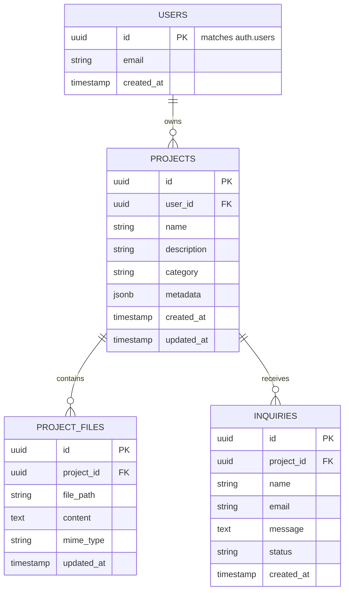

# Database Design & Supabase Integration (database.md)
## VibeForge 2.0 — Data Models, Schemas & Future Supabase Architecture

**Document Version:** 1.0.0  
**Phase:** Phase 1 (Local In-Memory) & Planned Phase 3 (Supabase Production Spec)  
**Author:** Antigravity Senior Database Architect & Backend Engineer  

---

### 1. Phase 1: Local In-Memory Data Models

In Phase 1, all data is maintained within predictable in-memory JavaScript state (`src/mockData.js`). No external network requests or database connections are initialized.

#### 1.1 Project Entity Contract (`Project`)
```typescript
interface Project {
  id: string;               // Unique slug/UUID, e.g. "proj-apex-innovate"
  name: string;             // Display name, e.g. "Apex Innovate - AI Robotics"
  description: string;      // Summary of the website
  category: 'Landing Page' | 'Portfolio' | 'E-Commerce' | 'SaaS' | 'Agency';
  thumbnailUrl: string;     // SVG or CSS gradient mockup preview
  updatedAt: string;        // Human-readable relative string, e.g. "12 mins ago"
  isDemo: boolean;          // Always true for Phase 1 demo projects
  files: ProjectFile[];     // Collection of virtual files
}
```

#### 1.2 File Entity Contract (`ProjectFile`)
```typescript
interface ProjectFile {
  id: string;               // e.g. "index-html"
  name: string;             // e.g. "index.html"
  path: string;             // e.g. "/index.html" or "/pages/about.html"
  type: 'html' | 'css' | 'js' | 'json';
  content: string;          // Source code content
  size: string;             // Display size, e.g. "4.2 KB"
}
```

#### 1.3 AI Chat Message Contract (`ChatMessage`)
```typescript
interface ChatMessage {
  id: string;
  sender: 'user' | 'assistant';
  text: string;
  timestamp: string;
  isSimulated: boolean;     // Flag to mark demo generation
}
```

---

### 2. Planned Phase 3: Supabase Production Database Architecture

In Phase 3, VibeForge will connect to Supabase (PostgreSQL 15+) for user accounts, cloud project synchronization, and contact form inquiry submissions.



---

### 3. Root Cause Analysis & Fix: `TypeError: Failed to fetch (Code: RLS_OR_SCHEMA_ERROR)`

#### 3.1 Understanding the Error
During prior troubleshooting, the user encountered:
`TypeError: Failed to fetch (Code: RLS_OR_SCHEMA_ERROR)`

**Crucial Technical Distinction:**
- In browser JavaScript, **`TypeError: Failed to fetch`** is an **OS/Network/Browser level failure**, NOT an HTTP response from PostgreSQL. It occurs when the browser cannot reach the Supabase REST endpoint (`https://xyz.supabase.co/rest/v1/inquiries`).
  - **Common Root Causes:**
    1. The `SUPABASE_URL` has a typo, missing `https://`, trailing slash issues, or incorrect project reference.
    2. An ad blocker (e.g. uBlock Origin, Brave Shields) or firewall is blocking requests to `*.supabase.co`.
    3. The client is offline or experiencing CORS issues.
- **`Code: RLS_OR_SCHEMA_ERROR`** is a custom wrapper catch-block that mistakenly classifies any catch failure as an RLS violation.
- **Genuine Postgres RLS or Schema errors** actually return an HTTP response (status `400` or `403` or `404`) with a JSON payload containing Postgres error codes:
  - `42501`: Row-level security violation (policy denies insert/select).
  - `42P01`: Undefined table (the `inquiries` table does not exist in the public schema).

#### 3.2 Production-Ready Supabase Schema & RLS Policy for `inquiries`

When connecting Supabase in Phase 3, execute this verified SQL script in the Supabase SQL Editor:

```sql
-- 1. Create inquiries table
CREATE TABLE IF NOT EXISTS public.inquiries (
    id UUID DEFAULT gen_random_uuid() PRIMARY KEY,
    created_at TIMESTAMP WITH TIME ZONE DEFAULT timezone('utc'::text, now()) NOT NULL,
    project_id UUID,
    name TEXT NOT NULL,
    email TEXT NOT NULL,
    message TEXT NOT NULL,
    status TEXT DEFAULT 'new' CHECK (status IN ('new', 'read', 'archived'))
);

-- 2. Enable Row Level Security (Mandatory for privacy)
ALTER TABLE public.inquiries ENABLE ROW LEVEL SECURITY;

-- 3. Policy: Allow public visitors (anon) to submit contact forms
CREATE POLICY "Allow public anon to insert inquiries"
ON public.inquiries
FOR INSERT
TO anon
WITH CHECK (
    char_length(name) >= 2 AND
    char_length(email) >= 5 AND
    char_length(message) >= 5
);

-- 4. Policy: Prevent public anon from reading inquiries
-- (Only authenticated project owners can read submissions)
CREATE POLICY "Allow authenticated users to read inquiries"
ON public.inquiries
FOR SELECT
TO authenticated
USING (true);

-- 5. Create index for query performance
CREATE INDEX IF NOT EXISTS idx_inquiries_project_id ON public.inquiries(project_id);
```

#### 3.3 Robust Client Submission Code Pattern
```javascript
// Clean client submission avoiding false RLS classifications:
async function submitInquiry(supabaseClient, inquiryData) {
  try {
    const { data, error, status } = await supabaseClient
      .from('inquiries')
      .insert([inquiryData]);

    if (error) {
      if (status === 403 || error.code === '42501') {
        throw new Error('RLS Error: The database denied insertion. Check table policies.');
      } else if (status === 404 || error.code === '42P01') {
        throw new Error('Schema Error: Table "inquiries" does not exist.');
      } else {
        throw new Error(`Supabase Error (${error.code}): ${error.message}`);
      }
    }
    return { success: true, data };
  } catch (err) {
    if (err instanceof TypeError && err.message.includes('Failed to fetch')) {
      throw new Error('Network Error: Could not reach Supabase endpoint. Check your URL and disable ad-blockers.');
    }
    throw err;
  }
}
```
