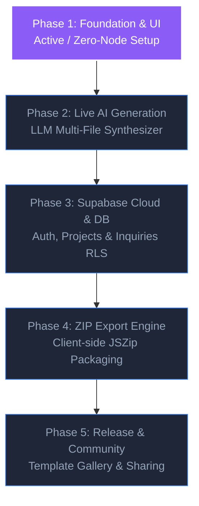

# Implementation Roadmap & Verification Gates (phases.md)
## VibeForge 2.0 — Phased Execution Plan & Quality Gates

**Document Version:** 1.0.0  
**Current Phase:** Phase 1 (Foundation & UI)  
**Author:** Antigravity Senior Technical Program Manager & Lead Architect  

---

### 1. Project Implementation Roadmap

---

### 2. Phase Breakdown & Tasks

#### Phase 1: Foundation & UI (Current Phase)
- **Objective:** Build an accessible, standalone React + Tailwind application with full UI scaffolding, mock data, responsive viewports, file explorer, code viewer, and sandboxed preview.
- **Prerequisites:** Modern web browser (Chrome, Edge, Firefox, or Safari). Zero Node.js requirement.
- **Tasks:**
  - `TASK-101`: Initialize root `index.html` with React 18, Babel standalone, Tailwind Play CDN, and dark theme design tokens.
  - `TASK-102`: Create global style definitions (`src/index.css`) for custom scrollbars, animations, and glassmorphic cards.
  - `TASK-103`: Build data models and sample dataset (`src/mockData.js`) containing demo projects, prompt presets, and chat history.
  - `TASK-104`: Author realistic, multi-section sample website (`src/sampleWebsite.js`) with responsive navigation, hero, features, stats, contact form, and footer.
  - `TASK-105`: Build Dashboard view with project search, category filtering, and empty states (`src/components/Dashboard.jsx`).
  - `TASK-106`: Build creation modal with prompt validation (>= 10 chars), preset quick-fills, and explicit Demo Mode notices (`src/components/CreateModal.jsx`).
  - `TASK-107`: Build Builder top toolbar with viewport toggles (desktop/tablet/mobile), view tabs (preview/code/files), and export placeholder action (`src/components/BuilderToolbar.jsx`).
  - `TASK-108`: Build File Explorer component with file tree navigation and active file states (`src/components/FileExplorer.jsx`).
  - `TASK-109`: Build Code Viewer with syntax formatting cues, line numbers, and clipboard copy action (`src/components/CodeViewer.jsx`).
  - `TASK-110`: Build Preview Canvas with secure sandboxed iframe and animated viewport resizing (`src/components/PreviewCanvas.jsx`).
  - `TASK-111`: Build AI Chat Assistant drawer with simulated responses and prompt suggestion pills (`src/components/AIChatPanel.jsx`).
  - `TASK-112`: Build Toast notification and Informational Modal systems (`src/components/Toast.jsx`).
  - `TASK-113`: Assemble top-level application orchestration and state router in `src/App.jsx`.
  - `TASK-114`: Perform cross-browser validation and responsive testing.
- **Phase 1 Exit Criteria:**
  1. Application renders cleanly in a browser without console errors.
  2. All navigation transitions (Dashboard <-> Builder) function smoothly.
  3. Search and category filters operate instantaneously.
  4. Viewport switcher visibly resizes preview canvas between 100%, 768px, and 375px.
  5. File selection switches code viewer content.
  6. Demo mode notices are prominently displayed for AI and Export actions.

---

#### Phase 2: Live AI Website Generation Engine
- **Objective:** Connect a live LLM endpoint to generate multi-file code (HTML, CSS, JS) based on arbitrary user prompts.
- **Tasks:**
  - `TASK-201`: Design structured multi-file generation system prompt with JSON schema output.
  - `TASK-202`: Implement client-side streaming response parser to display live code creation progress.
  - `TASK-203`: Build interactive chat refinement loop allowing users to request targeted modifications (e.g., "Change hero colors to emerald").
  - `TASK-204`: Implement HTML/CSS validator to catch unclosed tags before injecting into iframe.

---

#### Phase 3: Supabase Cloud & Contact Inquiries
- **Objective:** Provide persistent project storage and validated contact form submissions with verified Row Level Security (RLS).
- **Tasks:**
  - `TASK-301`: Integrate `@supabase/supabase-js` via ESM CDN without requiring npm installs.
  - `TASK-302`: Implement user authentication (Magic Link or Email/Password).
  - `TASK-303`: Deploy `inquiries` table with verified public `anon` `INSERT` policy and authenticated owner `SELECT` policy.
  - `TASK-304`: Provide real-time inquiry management inbox inside the VibeForge builder.
  - `TASK-305`: Build diagnostic connection tester to catch network blocks vs RLS violations.

---

#### Phase 4: Client-Side ZIP Export Engine
- **Objective:** Allow one-click download of generated websites as clean, runnable zip archives.
- **Tasks:**
  - `TASK-401`: Integrate JSZip and FileSaver via browser ESM CDN.
  - `TASK-402`: Compile project files (`index.html`, `styles.css`, `main.js`, assets) into a structured zip buffer.
  - `TASK-403`: Trigger automated file download with project name slug.
  - `TASK-404`: Validate that exported zip files extract and run standalone on Windows Explorer.

---

#### Phase 5: Template Gallery & Community Sharing
- **Objective:** Public showcase and community template cloning.
- **Tasks:**
  - `TASK-501`: Public gallery page displaying featured community websites.
  - `TASK-502`: "Remix Website" action enabling one-click cloning into personal workspace.
  - `TASK-503`: Performance and SEO audit tools for generated websites.

---

### 3. Phase 1 Verification Gate Checklist

| Checkpoint | Target Result | Verification Status |
| :--- | :--- | :--- |
| **Zero Runtime Execution** | No Node.js required; runs natively in browser | Pending Implementation |
| **Interactive Dashboard** | Search, filter, demo project cards render | Pending Implementation |
| **Prompt Validation** | Prevents submission when prompt < 10 chars | Pending Implementation |
| **Responsive Viewports** | Canvas animates to 100%, 768px, 375px | Pending Implementation |
| **File Tree & Code Viewer** | Clicking files updates source code view | Pending Implementation |
| **Sandboxed Preview** | Realistic sample website renders inside iframe | Pending Implementation |
| **Demo Mode Transparency**| Clear badges on AI and Export actions | Pending Implementation |
